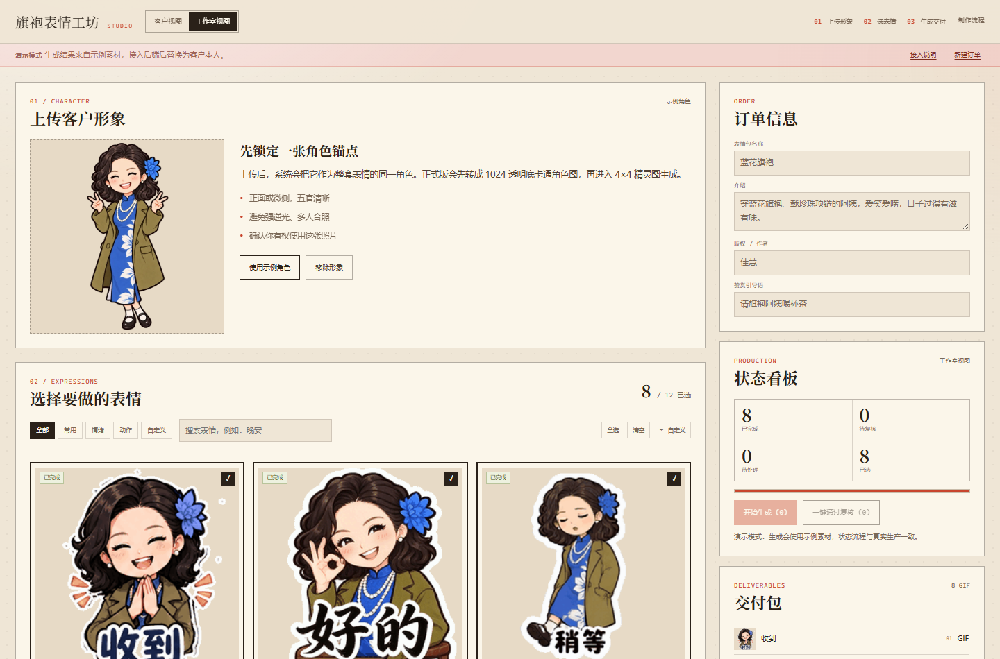
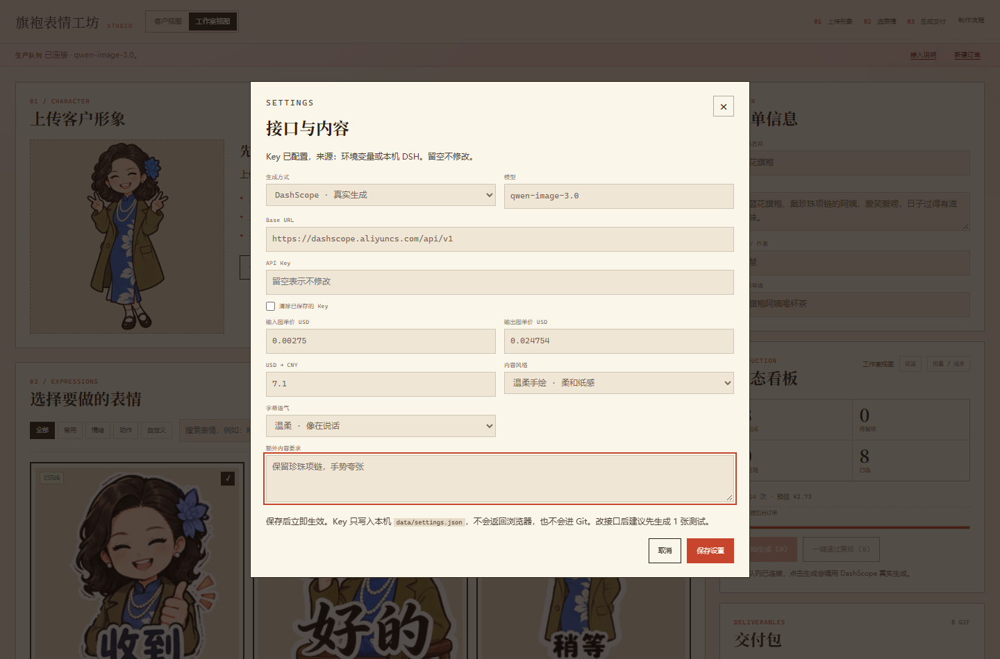
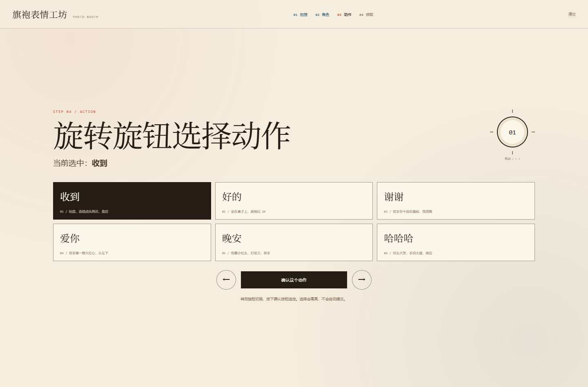

# 旗袍表情工坊 / Sticker Studio

一个本地优先的微信表情包定制工作台：上传角色、选表情、跑真实生成队列、逐张复核、导出可上架的 ZIP。

不是教程，也不是案例页，而是一个能跑的前后端产品原型。前端是原生 HTML/CSS/JS，后端是 Python 标准库 HTTP 服务 + SQLite + 线程队列，生成侧接 DashScope `qwen-image-3.0`。



## 能做什么

- 上传客户照片，本地压缩预览，保存到浏览器
- 12 个默认表情，支持分类、搜索、全选、清空、自定义新增
- 每个表情独立状态：`draft / queued / generating / review / done / failed`
- 每个表情独立提示词，可查看、编辑、复制、按模板重写
- 工作室视图与客户视图切换，客户只看选择与提交
- 真实生成队列：角色锚定、精灵图、去底、切帧、GIF、配套素材
- 状态看板、进度、逐张复核、一键通过
- 交付包：所选 GIF、ICON、封面、横幅、赞赏图、上架文案、`pack.json`
- 服务端 ZIP，也保留纯前端 ZIP 作为静态预览降级
- 真实 API 调用次数与成本统计，按官方单价估算
- 生成前确认预计调用次数与金额，避免误点烧钱
- 生成中可刷新页面，订单号持久化，自动续接后台进度
- 本地 `.env` 与真实订单数据不会进入 Git

## 快速开始

要求 Python 3.10+，Windows / macOS / Linux 都可以。

```bash
git clone https://github.com/gao666-max/sticker-studio.git
cd sticker-studio
python -m venv .venv
# Windows
.venv\Scripts\activate
# macOS / Linux
# source .venv/bin/activate
pip install -r requirements.txt
copy .env.example .env   # Windows
# cp .env.example .env   # macOS / Linux
python server.py
```

打开 `http://127.0.0.1:8787/`。

Windows 也可以直接双击 `start-studio.bat`。

默认是 `demo` 模式，用仓库内示例素材走完整队列，不调用模型，不产生费用。

## 接真实生成

编辑 `.env`：

```ini
IMAGE_PROVIDER=dashscope
DASHSCOPE_API_KEY=你的百炼 Key
DASHSCOPE_MODEL=qwen-image-3.0
USE_DSH_CREDENTIALS=0
```

然后重启 `python server.py`。

说明：

- Key 只留在服务端，不会进入浏览器，也不会被提交到 Git
- `USE_DSH_CREDENTIALS=1` 是本地开发便利：从 `~/.dsh/.credentials.yaml` 读取 DSH 已配置的 Key。默认关闭，公开部署请保持 `0`
- 不要把 `127.0.0.1:8787` 直接暴露到公网。没有鉴权，没有多租户隔离，只适合本机或内网

真实生成点「开始生成」会先弹确认：

```text
真实生成会调用 DashScope，预计 14 次，约 ¥2.73。继续？
```

确认后才会计费。

## 后台设置

状态看板右上角有「设置」，不用改 `.env` 也能改：

- 生成方式：`Demo` 或 `DashScope`
- 模型、Base URL、API Key
- 输入图 / 输出图单价、USD 到 CNY 汇率
- 内容风格：可爱贴纸、温柔手绘、夸张搞笑
- 字幕语气：短词、温柔、俏皮
- 额外内容要求，例如「保留珍珠项链，手势夸张」

保存后立即生效。Key 只写本机 `data/settings.json`，接口不会把 Key 返回给浏览器，`data/` 也在 `.gitignore` 里。

内容风格、字幕语气和额外要求会直接重写**没有手动改过**的提示词。已经手动改过的提示词会保留，不会被覆盖。

当前只适配 DashScope 兼容接口。要接 OpenAI、即梦或其他厂商，需要在 `pipeline.py` 里新增 adapter。

## 风格锁与角色母版

固定画风在 `style_lock.txt`，蓝花旗袍角色细节在 `character_lock.txt`，动作模板在 `action_template.txt`。生成时不再每次重写画风，只改动作和表情。

- 角色母版只上传一次，所有表情、头像、封面都引用它
- 母版用干净透明 PNG，不要拿带棋盘格和字幕的成品截图当母版
- 4×4 提示词强制 16 格是同一个角色，只允许姿势、表情和小道具变化
- Kiosk 近景默认半身，避免给自拍硬编一个身体



## 现场拍照亭

顶部「现场模式」打开 `kiosk.html`，这是一条给线下设备用的全屏流程。Windows 也可以双击 `start-kiosk.bat`，它会启动后端并自动打开页面。

```text
拍照 → 1024 透明卡通角色 → 选动作 → GIF → 二维码 → 手机领取
```

- 摄像头实时预览，实体快门 / 空格键拍照
- 角色生成有进度、失败重试、重拍
- 旋钮用方向键 / 滚轮模拟，高亮同步，确认才提交
- 近景默认半身贴纸，可切全身，避免模型给自拍硬编一个身体
- GIF 默认 `KIOSK_GIF_MODE=keypose`，先生成 AI 动作关键姿势，再做轻动效，约 30 到 60 秒
- `KIOSK_GIF_MODE=motion` 最快，1 到 2 秒，但动作是程序化位移
- AI 4×4 GIF 设 `KIOSK_GIF_MODE=ai`，更慢
- 二维码绑定唯一 token，30 分钟有效，领取页可下载 / 分享
- 手机扫码需要 `STUDIO_HOST=0.0.0.0` 和 `PUBLIC_BASE_URL`

真实照片的 1024 透明角色已经实测：纯白背景卡通化、去底、质量门、1024 RGBA。



硬件桥接、状态机、二维码和接口见 [KIOSK.md](KIOSK.md)。

## 成本统计

`GET /api/usage` 返回累计、今日、本月、近 14 天、按类型、最近调用与预估成本。

单价按阿里云百炼 [qwen-image-3.0 官方价格](https://www.alibabacloud.com/help/zh/model-studio/qwen-image-3-0) 估算：

- 输出图 `$0.024754 / 张`
- 输入图 `$0.00275 / 张`
- 汇率默认 `7.1`
- 失败请求按 0 计

一套 8 个表情加 5 张素材和 1 次角色锚定，约 14 次调用，约 `¥2.73 / 套`。

**这是估算，不是账单。** 最终金额以百炼账单为准。要拿真实账单，需要接阿里云 Billing API，目前没有做。

## 结构

```text
sticker-studio/
├─ index.html          # 页面结构
├─ styles.css          # 暖纸、宋体、青花蓝的编辑风 UI
├─ app.js              # 状态机、轮询、续接、ZIP、成本面板
├─ kiosk.html          # 现场拍照亭
├─ kiosk.css
├─ kiosk.js
├─ claim.html          # 手机领取页
├─ claim.css
├─ claim.js
├─ start-kiosk.bat
├─ server.py           # 静态服务 + 订单 / Kiosk API + SQLite + 队列 + ZIP
├─ pipeline.py         # 去底、1024 角色、切帧、GIF、DashScope 适配
├─ serve.py            # 纯静态预览，不接后端时备用
├─ start-studio.bat
├─ requirements.txt
├─ .env.example
├─ BACKEND.md          # 接口、队列、数据模型
├─ KIOSK.md            # 拍照亭流程、硬件与二维码
├─ style_lock.txt      # 固定画风
├─ character_lock.txt  # 蓝花旗袍角色细节
├─ action_template.txt # 动作模板
├─ workflow.md         # 完整生产工作流与提示词
├─ workflow.yaml       # 参数化版本
├─ assets/             # 演示素材
│  ├─ character.webp
│  ├─ character_master.png
└─ data/               # 运行时订单与生成结果，已 gitignore
```

## API

| 方法 | 路径 | 说明 |
|---|---|---|
| GET | `/api/health` | 后端状态、provider、Key 是否配置 |
| GET | `/api/settings` | 非敏感设置、Key 是否配置 |
| POST | `/api/settings` | 保存 provider、模型、Key、价格、内容风格 |
| GET | `/api/usage` | 调用次数、成本、趋势、最近调用 |
| POST | `/api/kiosk/sessions` | 上传照片，创建拍照亭会话 |
| GET | `/api/kiosk/sessions/{id}` | 查询角色、GIF、二维码 |
| POST | `/api/kiosk/sessions/{id}/gif` | 选择动作，生成 GIF |
| GET | `/claim/{token}` | 手机领取页 |
| GET | `/api/orders` | 最近订单 |
| POST | `/api/orders` | 创建订单，角色图 + pack + states |
| POST | `/api/orders/{id}/generate` | 入队生成 |
| GET | `/api/orders/{id}` | 查询订单与逐张状态 |
| POST | `/api/orders/{id}/review` | 复核 |
| GET | `/api/orders/{id}/zip` | 服务端交付 ZIP |
| GET | `/api/orders/{id}/files/{name}` | 订单素材 |

更细的字段见 [BACKEND.md](BACKEND.md)。

## 隐私与安全

- 上传的角色图、订单、生成结果都在 `data/`，已加入 `.gitignore`
- `.env` 已加入 `.gitignore`，不要提交真实 Key
- 演示素材是仓库自带插画，不是客户照片
- 生产环境至少需要：登录鉴权、订单隔离、上传校验、限流、对象存储、失败重试、预算上限
- 不要用这个原型直接接收陌生人的照片或公开部署

## 演示素材授权

代码是 MIT。`assets/` 里的演示角色、表情 GIF 和配套 PNG 只用于让项目开箱可跑，**不随 MIT 授权商用或再分发**，也不可用于训练生成模型。详见 [ASSETS.md](ASSETS.md)。

如果你要商用，请替换 `assets/character.webp`、`assets/gif-*.gif`、`assets/love-smooth.gif`、`assets/ask.gif` 和 `assets/deliver/*`。

## 已知限制

- 队列在内存里，服务重启会丢失正在排队的任务
- 真实生成一张约 20 到 60 秒，一套 8 张通常 5 到 15 分钟
- 4×4 精灵图不保证 16 格完全正确，需要人工复核
- 中文错字、假透明、角色漂移仍需质检
- 没有账号、支付、订单列表和公网鉴权
- 成本是估算，不是账单

## License

代码 MIT。演示素材除外，见 [ASSETS.md](ASSETS.md)。
